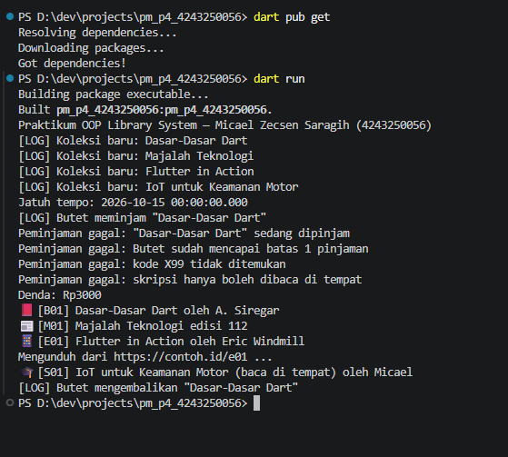
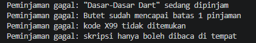
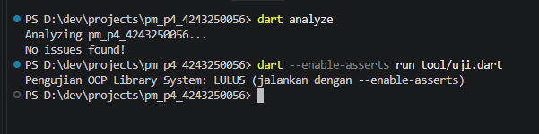

# Praktikum Pertemuan 4 — OOP Library System

## Identitas Mahasiswa

| Atribut | Keterangan |
|---|---|
| **Nama** | Micael Zecsen Saragih |
| **NIM** | 4243250056 |
| **Kelas** | PSIK24D |
| **Universitas** | Universitas Negeri Medan |
| **Mata Kuliah** | Pemrograman Mobile |

## Sumber Materi

Modul Pertemuan 4 bagian B–C (halaman 16–20), materi A.1–A.11, dan slide Pertemuan 4 (OOP & Async Programming).

## Deskripsi

Program Dart console yang mensimulasikan sistem perpustakaan digital. Sistem mengelola koleksi buku, majalah, e-book, dan skripsi dengan fitur peminjaman asinkron, penanganan exception, notifikasi kejadian melalui Stream, dan perhitungan denda keterlambatan.

## Fitur Utama

### Hierarki Koleksi

- `sealed class Koleksi` dengan empat subclass: `Buku`, `Majalah`, `EBook`, dan `Skripsi`.
- Setiap subclass mengimplementasikan getter `lamaPinjam` dan method `info()` sesuai jenisnya.
- `EBook extends Buku with BisaDiunduh` — mixin menambahkan getter `url` dan method `unduh()`.
- `Skripsi` memiliki `lamaPinjam = 0` dan hanya boleh dibaca di tempat.

### Enkapsulasi

- Field `_dipinjam` pada `Koleksi` bersifat privat di tingkat library Dart.
- Kode di luar `lib/model.dart` tidak dapat mengakses `_dipinjam` secara langsung.
- Perubahan status dilakukan melalui method publik `tandaiDipinjam()` dan `tandaiDikembalikan()`.
- `Perpustakaan` menyimpan daftar koleksi dan peminjaman aktif secara privat; akses luar melalui getter `koleksiTersedia` dan `pinjamanAktif`.

### Async Programming

- Method `pinjam()` di `Perpustakaan` menggunakan `async/await` dengan `Future.delayed` untuk mensimulasikan proses verifikasi.
- Setiap kejadian pinjam dan kembali dicatat melalui `StreamController.broadcast()` — listener pos jaga menerima log secara real-time.
- Denda dihitung Rp1.000/hari setelah jatuh tempo.

### Exception

- `PeminjamanGagal` menangani empat kondisi: kode tidak ditemukan, koleksi sedang dipinjam, batas pinjam anggota terlampaui, dan skripsi tidak boleh dipinjam.

## Tiga Tantangan Praktikum

### Tantangan 1 — Pemisahan Model dan Layanan

Implementasi awal menempatkan semua kode dalam satu file. Tantangannya adalah memindahkan model ke `lib/model.dart` dan layanan ke `lib/perpustakaan.dart` tanpa mengekspos field internal.

Masalah utama: field `_dipinjam` pada `sealed class Koleksi` bersifat privat di tingkat **library**, bukan kelas. Artinya `lib/perpustakaan.dart` tidak dapat mengakses `_dipinjam` secara langsung karena berada di library berbeda.

Solusi: menambahkan method publik `tandaiDipinjam()` dan `tandaiDikembalikan()` pada `Koleksi`. Method ini menjadi satu-satunya jalur untuk mengubah status pinjam, sehingga enkapsulasi tetap terjaga — tidak ada kode di luar model yang dapat mengubah `_dipinjam` secara sembarangan.

### Tantangan 2 — Kelas Skripsi

Menambahkan `Skripsi extends Koleksi` dengan perilaku khusus:

- `lamaPinjam` bernilai `0` karena skripsi tidak dipinjamkan.
- `info()` menyertakan keterangan `(baca di tempat)` dan nama penulis.
- Di `Perpustakaan.pinjam()`, percobaan meminjam skripsi langsung melempar `PeminjamanGagal('skripsi hanya boleh dibaca di tempat')` sebelum pengecekan lainnya, sehingga penolakan bersifat eksplisit dan tidak bergantung pada nilai `lamaPinjam`.

### Tantangan 3 — Sealed Class dan Pattern Matching

Menggunakan `sealed class Koleksi` bersama fungsi top-level `ikon()` yang memanfaatkan switch expression:

```dart
String ikon(Koleksi koleksi) => switch (koleksi) {
      EBook() => '📱',
      Buku() => '📕',
      Majalah() => '📰',
      Skripsi() => '🎓',
    };
```

Karena `Koleksi` bersifat `sealed`, Dart analyzer mengetahui secara tepat seluruh subclass yang mungkin. Jika ada subclass baru yang ditambahkan ke `lib/model.dart` tetapi belum dicakup dalam switch di atas, analyzer langsung menandai switch sebagai *non-exhaustive* pada waktu kompilasi — tanpa perlu menjalankan program. Ini merupakan jaminan keamanan tipe yang tidak bisa diperoleh dari kelas biasa.

## Cara Menjalankan

```powershell
dart pub get
dart run
```

Atau secara eksplisit:

```powershell
dart run bin/pm_p4_4243250056.dart
```

Menjalankan contoh-contoh materi:

```powershell
dart run examples/a1_a3_oop.dart
dart run examples/a5_a6_enum_generics.dart
dart run examples/a9_future.dart
dart run examples/a10_stream.dart
dart run examples/a11_file.dart
```

## Pemeriksaan

```powershell
dart format .
dart analyze
dart --enable-asserts run tool/uji.dart
```

## Struktur Project

| Lokasi | Fungsi |
|---|---|
| `bin/pm_p4_4243250056.dart` | Demonstrasi kasus lengkap dan output |
| `lib/model.dart` | Hierarki koleksi (`sealed class`), mixin `BisaDiunduh`, `Anggota`, `Peminjaman`, `PeminjamanGagal`, fungsi `ikon()` |
| `lib/perpustakaan.dart` | Layanan perpustakaan, peminjaman async, log Stream |
| `examples/a1_a3_oop.dart` | Contoh OOP dasar — A.1 dan A.3 |
| `examples/a5_a6_enum_generics.dart` | Contoh enum dan generics — A.5 dan A.6 |
| `examples/a9_future.dart` | Contoh Future async — A.9 |
| `examples/a10_stream.dart` | Contoh Stream — A.10 |
| `examples/a11_file.dart` | Contoh File I/O — A.11 |
| `tool/uji.dart` | Pengujian tanpa paket eksternal |
| `docs/` | Screenshot hasil praktikum |

## Bukti Screenshot

### Screenshot 1 — Output Sistem Perpustakaan



Menampilkan proses penambahan koleksi, peminjaman berhasil, jatuh tempo, dan perhitungan denda.

### Screenshot 2 — Penanganan Kesalahan Peminjaman



Menampilkan kode tidak ditemukan, buku sedang dipinjam, batas pinjam terlampaui, dan penolakan skripsi (hanya boleh dibaca di tempat).

### Screenshot 3 — Contoh Materi dan Pengujian



Menampilkan hasil `dart analyze` bersih (no issues found), contoh-contoh materi A.1–A.11, dan hasil skrip pengujian `tool/uji.dart`.

## Pengujian

Skrip `tool/uji.dart` memverifikasi:

- Getter `lamaPinjam` tiap subclass: `Buku` = 14 hari, `Majalah` = 7 hari, `EBook` = 30 hari, `Skripsi` = 0 hari.
- Fungsi `ikon()` mengembalikan simbol yang tepat untuk tiap subclass.
- Peminjaman berhasil dan tanggal `jatuhTempo` dihitung dengan benar.
- `PeminjamanGagal` dilempar untuk empat kasus: koleksi sedang dipinjam, batas pinjam anggota, kode tidak ditemukan, dan skripsi.
- Denda keterlambatan dihitung Rp1.000/hari (3 hari terlambat = Rp3.000).
- Koleksi kembali tersedia setelah dikembalikan.

Hasil pengujian: **LULUS** (tidak ada error, semua assertion terpenuhi).

## Refleksi

1. **extends vs implements vs with**: `extends` untuk mewarisi perilaku (`EBook extends Buku`); `implements` untuk memenuhi kontrak seperti `PeminjamanGagal implements Exception`; `with` untuk menambahkan perilaku yang dapat digunakan ulang seperti `BisaDiunduh`.
2. **await dan event loop**: `await` di dalam `pinjam()` menunda kelanjutan fungsi sampai `Future.delayed` selesai, tetapi event loop tetap berjalan — program tidak memblokir seluruh thread.
3. **Future vs Stream**: `Future` menghasilkan satu nilai di masa depan (contoh: hasil `pinjam()`); `Stream` menghasilkan serangkaian nilai (contoh: log kejadian perpustakaan yang terus mengalir).

## Pernyataan Penggunaan AI

ChatGPT digunakan untuk membantu merancang kode, dokumentasi, dan skrip pengujian. Mahasiswa bertanggung jawab membaca kode, menjalankan pengujian, mengumpulkan screenshot asli, dan memastikan hasil sesuai instruksi dosen.
